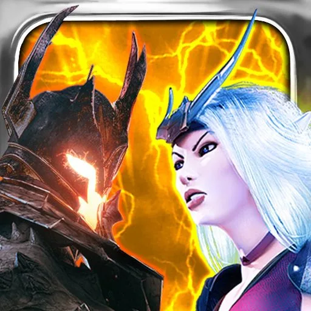
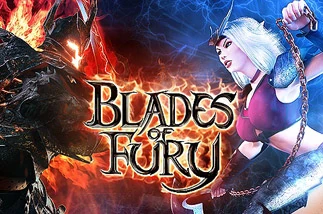
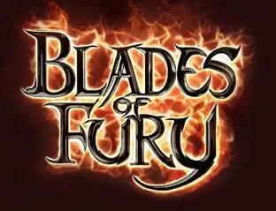

# Blades of Fury — PS Vita Port

<p align="center">
  
</p>

<p align="center">
  <b>A native PlayStation Vita port of Gameloft's classic 3D weapon-based fighting game <i>Blades of Fury</i> (iOS 1.1.3).</b>
</p>

<p align="center">
  
  &nbsp;&nbsp;
  
</p>

---

## Overview

*Blades of Fury* is a high-octane 3D weapon-based fighting game developed and published by Gameloft in 2009 for iOS, heavily inspired by arcade classics such as *Soulcalibur*. It features 10 unique warriors, diverse combat arenas, armor destruction mechanics, devastating magic attacks, and multiple game modes (Story, Arcade, Survival, and Practice).

This port directly loads and executes the original ARMv6 32-bit Mach-O executable on the PlayStation Vita's ARM Cortex-A9 processor, bridging iOS system frameworks (UIKit, CoreFoundation, OpenGLES 1.1, OpenAL) through custom translation layers.

---

## Features

- **Full Native Execution:** Runs the original decrypted iOS executable (`BladesOfFury`) natively without CPU emulation.
- **Widescreen 960x544 Display:** Scaled to fill the entire PlayStation Vita OLED/LCD screen (no black bars or letterboxing).
- **Physical Controls:** Fully mapped D-Pad, Left Analog Stick, Face Buttons ($\square$, $\Delta$, $\bigcirc$, $\times$), and Shoulder Triggers (L1/R1).
- **Capacitive Touchscreen Support:** Front touchscreen remains active for seamless menu navigation and character selection.
- **VFP Vector Mode Emulation:** Transparently patches legacy ARMv6 VFPv2 vector mode (`FPSCR.LEN = 3`) math routines with standard scalar math to prevent crashes on Cortex-A9.
- **Complete Audio Support (SFX + BGM):**
  - **Sound Effects & Voices:** Native RIFF/WAVE parsing and spatial playback through **OpenAL** (`sfx_*.wav`, `vfx_*.wav`).
  - **Background Music:** Dedicated OpenAL stream engine playing high-fidelity 32 kHz stereo tracks across all menus and arenas.
- **On-the-fly CgBI PNG Decoding:** Decodes Apple's proprietary CgBI-compressed PNG assets directly at runtime without requiring manual PC preprocessing.
- **Diagnostic Logging System:** Automatic rotating log manager saving runtime logs to `ux0:data/bladesoffury/logs/log_XXX.log`.

---

## Controls

| PS Vita Button | Action / In-Game Function | Virtual HUD Target |
| :--- | :--- | :--- |
| **Left Analog Stick** | Move / 8-Way Virtual Joystick | Analog Joystick `(80, 250)` |
| **D-Pad (Cruceta)** | 8-Way Movement | Virtual D-Pad `(80, 250)` |
| **$\square$ (Square)** | Horizontal Slash (Attack A) | `(361, 255)` |
| **$\Delta$ (Triangle)** | Vertical Slash (Attack B) | `(410, 206)` |
| **$\bigcirc$ (Circle) / R1** | Magic / Kick / Special (Attack C) | `(430, 157)` |
| **$\times$ (Cross) / L1** | Guard / Defense (Attack D) | `(430, 270)` |
| **START** | Pause Game / In-Game Menu | `(455, 25)` |
| **Front Touchscreen** | Menu Navigation, Character Selection, Dialogs | Direct 1:1 screen mapping |

---

## Prerequisites & Required Plugins

Ensure your PS Vita is running Henkaku / Enso with the following plugins installed in your `ur0:tai/config.txt`:

1. **kubridge:** Required for user-memory dynamic mapping (`kuKernelAllocMemBlock`).
2. **fd_fix:** Prevents file descriptor crashes when opening multiple archives or assets simultaneously.
3. **libshacccg.suprx:** Required by `vitaGL` for runtime shader compilation. If you don't have it installed, use [ShaRKBR33D](https://github.com/OsirizX/ShaRKBR33D) to extract it easily.

Example `ur0:tai/config.txt`:
```ini
*KERNEL
ur0:tai/kubridge.skprx
ur0:tai/fd_fix.skprx
```

---

## Installation Guide

### Step 1: Install the VPK
Download and install [`bladesoffury.vpk`](file:///Volumes/TOSHIBA%20EXT/PSVITA%20Develop/Blades-of-Fury-vita/build/bladesoffury.vpk) using VitaShell.

### Step 2: Prepare Game Data
You must provide your own legitimately acquired copy of *Blades of Fury* for iOS (v1.1.3 `.ipa`):

1. Rename `Blades of Fury_v.1.1.3.ipa` to `.zip` and extract its contents.
2. Inside `Payload/`, locate the `BladesOfFury.app` folder.
3. Ensure the main binary `BladesOfFury.app/BladesOfFury` is decrypted (`cryptid = 0`).
4. Generate the relocation table `rebase.bin` and convert the music tracks:
   ```bash
   # From the port repository root:
   python3 tools/macho_prep.py path/to/BladesOfFury.app/BladesOfFury ux0_data/bladesoffury/rebase.bin
   tools/stage_data.sh path/to/BladesOfFury.app
   ```
5. Transfer the contents of `ux0_data/bladesoffury/` to your PS Vita at `ux0:data/bladesoffury/` via FTP or USB:

```
ux0:data/bladesoffury/
  ├── BladesOfFury.app/
  │     ├── BladesOfFury      (Decrypted 32-bit Mach-O executable)
  │     ├── Info.plist
  │     ├── *.bar, *.epk      (Game data archives)
  │     ├── sfx_*.wav         (Sound effects and voices)
  │     ├── m_*.wav           (Converted BGM tracks)
  │     └── ...
  ├── rebase.bin              (Generated relocation table)
  ├── saves/                  (Auto-created save data directory)
  └── logs/                   (Auto-created diagnostic logs)
```

6. Launch **Blades of Fury** from your PS Vita LiveArea!

---

## Building from Source

### Requirements
- [VitaSDK](https://vitasdk.org/) installed and added to your `$PATH`.
- CMake (>= 3.16).
- Python 3.8+.
- OpenAL-soft for VitaSDK (`vita-makepkg` / `vdpm`).

### Compilation
```bash
# Clone the repository:
git clone https://github.com/username/Blades-of-Fury-vita.git
cd Blades-of-Fury-vita

# Configure and compile:
cmake -B build
cmake --build build --parallel 8
```

This will produce:
- `build/eboot.bin`
- `build/bladesoffury.vpk`

---

## Technical Architecture & Notes

- **ABI Compatibility:** Compiled with `-ffixed-r9` to protect Apple's scratch register convention against Vita's AAPCS expectations. All guest execution jumps are dispatched via `call_guest` / `call_guest6` in [`source/asm.S`](file:///Volumes/TOSHIBA%20EXT/PSVITA%20Develop/Blades-of-Fury-vita/source/asm.S).
- **Stack Re-alignment:** 32-bit iOS uses 4-byte stack alignment, whereas VitaSDK newlib expects 8 bytes. `ml_align_call` automatically re-aligns `sp` across all callback boundaries.
- **Custom Darwin Memory Relocation:** Because early iOS binaries are non-PIE and lack standard dynamic relocations, `tools/macho_prep.py` scans code literals, jump tables, Objective-C selectors, and class references to generate a compact `rebase.bin` table applied at runtime.
- **Audio Pipeline:** Standard CoreAudio calls (`AudioFileOpenURL`, `AudioFileReadBytes`, `AudioFileGetProperty`) are intercepted in [`source/coreaudio.c`](file:///Volumes/TOSHIBA%20EXT/PSVITA%20Develop/Blades-of-Fury-vita/source/coreaudio.c) and routed directly to OpenAL PCM buffers.

---

## Credits & Acknowledgments

- **Gameloft:** For developing and publishing the original *Blades of Fury*.
- **Rinnegatamante:** For [`vitaGL`](https://github.com/Rinnegatamante/vitaGL) and foundational work in the PS Vita porting scene.
- **TheFloW:** For [`kubridge`](https://github.com/TheOfficialFloW/kubridge).
- **VitaSDK Team:** For the comprehensive open-source toolchain.
- **Wonder Diaz:** PS Vita loader port, translation layers, controls, and optimization.
