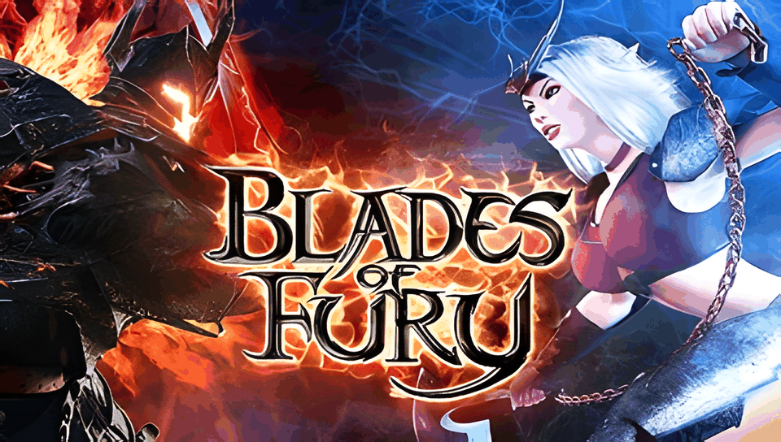
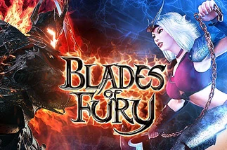
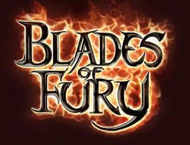

<h1 align="center">
  <br>
  Blades of Fury · PS Vita Port
</h1>

<p align="center">
  <b>Native port of Blades of Fury (Gameloft) for PlayStation Vita and PlayStation TV.</b>
</p>

<p align="center">
  
  
  
  
  
  
</p>

<p align="center">
  <a href="#-description">Description</a> •
  <a href="#-features">Features</a> •
  <a href="#-controls">Controls</a> •
  <a href="#-installation">Installation</a> •
  <a href="#-known-issues">Known Issues</a> •
  <a href="#-building-from-source">Build</a> •
  <a href="#-credits">Credits</a>
</p>

<p align="center">
  
  &nbsp;&nbsp;
  
</p>

---

## 📖 Description

*Blades of Fury* is a high-octane 3D weapon-based fighting game developed and published by Gameloft in 2009 for iOS, heavily inspired by arcade classics such as *Soulcalibur*. It features 10 unique warriors, diverse combat arenas, armor destruction mechanics, devastating magic attacks, and multiple game modes (Story, Arcade, Survival, and Practice).

This port directly loads and executes the original ARMv6 32-bit Mach-O executable on the PlayStation Vita's ARM Cortex-A9 processor, bridging iOS system frameworks (UIKit, CoreFoundation, OpenGLES 1.1, OpenAL) through custom translation layers. The original iOS version is **1.1.3** (`Blades of Fury_v.1.1.3.ipa`, executable `BladesOfFury`).

### 🔧 Technical notes

- **Full Native Execution:** Runs the original decrypted iOS executable (`BladesOfFury`) natively without CPU emulation.
- **Widescreen 960x544 Display:** Scaled to fill the entire PlayStation Vita OLED/LCD screen (no black bars or letterboxing). An original-aspect mode (816x544 with black bars) is selectable in the options menu.
- **VFP Vector Mode Emulation:** Transparently patches legacy ARMv6 VFPv2 vector mode (`FPSCR.LEN = 3`) math routines with standard scalar math to prevent crashes on Cortex-A9.
- **On-the-fly CgBI PNG Decoding:** Decodes Apple's proprietary CgBI-compressed PNG assets directly at runtime (including BGR-to-RGB byte-swapping) without requiring manual PC preprocessing.
- **Diagnostic Logging System:** Automatic rotating log manager saving runtime logs to `ux0:data/bladesoffury/logs/log_XXX.log`.
- **ABI Compatibility:** Compiled with `-ffixed-r9` to protect Apple's scratch register convention against Vita's AAPCS expectations. All guest execution jumps are dispatched via `call_guest` / `call_guest6` in `source/asm.S`.
- **Stack Re-alignment:** 32-bit iOS uses 4-byte stack alignment, whereas VitaSDK newlib expects 8 bytes. `ml_align_call` automatically re-aligns `sp` across all callback boundaries.
- **Custom Darwin Memory Relocation:** Because early iOS binaries are non-PIE and lack standard dynamic relocations, `tools/macho_prep.py` scans code literals, jump tables, Objective-C selectors, and class references to generate a compact `rebase.bin` table applied at runtime.
- **Audio Pipeline:** Standard CoreAudio calls (`AudioFileOpenURL`, `AudioFileReadBytes`, `AudioFileGetProperty`) are intercepted in `source/coreaudio.c` and routed directly to OpenAL PCM buffers.

---

## 🎮 Status & Playability

**Status: In-game** (latest commit: v1.1.0)

Console runs have reached the game's combat rounds with background music, and the shadow and frame-rate fixes were tested on the console in the most recent runs. Some frame-time hitches are still under investigation (see [Known Issues](#-known-issues)).

- [x] **Mach-O loader**: `__TEXT` / `__DATA` mapped at fixed addresses, rebase table applied, imports bound. *Verified on console (runs 3–5 onward in the progress log).*
- [x] **Graphics**: vitaGL, full 960x544 presentation. Shadows drawn correctly after the fix in run 18. *Verified on console.*
- [x] **Audio (BGM)**: background music plays across rounds after the OpenAL context fix. *Verified on console (run 17).*
- [ ] **Sound effects and voices**: implemented through OpenAL; not separately confirmed in the progress log.
- [ ] **Intro video**: `title.m4v` played through SceAvPlayer (run 18); not separately confirmed.
- [ ] **Options menu**: new in this build and not yet tested on console.
- [ ] **Save data**: progress persistence was a console gate in the progress log; not confirmed.

---

## ✨ Features

| Feature | Status | Notes |
| :--- | :---: | :--- |
| Boots to gameplay | ✅ | Console runs reach the loader, the game's init and combat rounds |
| Graphics / renderer | 🟡 | Full-screen 960x544 via vitaGL; shadows fixed on console. Frame-time hitches under investigation |
| Audio & music | 🟡 | BGM confirmed on console (run 17). SFX and voices implemented, not separately confirmed |
| Video / cutscenes | 🧪 | `title.m4v` via SceAvPlayer; not separately confirmed |
| Physical buttons | 🧪 | D-Pad, sticks, Square / Triangle / Circle / Cross, L1 / R1 mapped; not separately confirmed |
| Analog sticks / camera | 🧪 | Left stick moves the character (8-way virtual joystick) |
| Touch screen | 🧪 | Front touchscreen for menus, character selection and dialogs |
| Button remapping / port menu | 🧪 | SELECT + START options menu; not tested on console |
| Save data | 🧪 | Saves to `ux0:data/bladesoffury/saves/`; persistence not confirmed |
| Native trophies | ➖ | No trophies in this port |
| Languages | 🧪 | Device-language hook fixed in run 9; not separately confirmed |
| Performance | 🟡 | Runtime `perf:` and `hitch:` profiler lines added; FPS limit option. Hitches still open |
| Online / IAP / ads | ➖ | Not part of this port |
| PS TV | 🧪 | Not tested on PS TV |

Legend: `✅ Working (verified on console) · 🧪 Implemented, not yet verified on console · 🟡 Partial · ❌ Not working · ➖ Not applicable · ❔ Not documented yet`

---

## 🎯 Controls

| PS Vita Button | Action / In-Game Function | Virtual HUD Target |
| :--- | :--- | :--- |
| **Left Analog Stick** | Move / 8-Way Virtual Joystick | Analog Joystick `(80, 250)` |
| **D-Pad (Cruceta)** | 8-Way Movement | Virtual D-Pad `(80, 250)` |
| **$\square$ (Square)** | Horizontal Slash (Attack A) | `(361, 255)` |
| **$\Delta$ (Triangle)** | Vertical Slash (Attack B) | `(410, 206)` |
| **$\bigcirc$ (Circle) / R1** | Magic / Kick / Special (Attack C) | `(430, 157)` |
| **$\times$ (Cross) / L1** | Guard / Defense (Attack D) | `(430, 270)` |
| **START** | Pause Game / In-Game Menu | `(455, 25)` |
| **Front Touchscreen** | Menu Navigation, Character Selection, Dialogs | Direct 1:1 screen mapping |
| **L + R** | Show / hide the on-screen pad | — |
| **SELECT + START** | Options menu (see below) | — |

Menu actions:

| PS Vita Button | Menu Action |
| :--- | :--- |
| **D-Pad** | Menu Navigation |
| **$\bigcirc$ (Circle) / R1** | Confirm |
| **$\times$ (Cross) / L1** | Cancel / Back |
| **START** | Pause |
| **Touchscreen** | Direct 1:1 Touch |

### ⚙️ Options

Press **SELECT + START** together at any time to pause the game and open the port's options panel. **D-Pad ↑/↓** picks a row, **←/→ or Cross** changes it, **Circle / Start** saves and closes. Settings are saved in `ux0:data/bladesoffury/options.txt`.

> [!NOTE]
> New in this build and **not yet tested on console**.

| Option | Values |
| :--- | :--- |
| **On-screen controls (L+R)** | Shown / Hidden (same as L + R; hidden by default) |
| **Screen size** | Full screen 960×544 (default) / Original aspect 816×544 with black bars; touch follows the mode |
| **Screen filter** | Bilinear (smooth) · Sharp bilinear (integer pre-scale, crisp) · Pixel (nearest) |
| **FPS counter** | Off / On (top-left corner) |
| **FPS limit** | Off (game pace) / 30 FPS cap |

---

## 📋 Prerequisites

Ensure your PS Vita is running Henkaku / Enso with the following plugins installed in your `ur0:tai/config.txt`:

1. **kubridge.skprx** (v0.8.1 or higher): Required for user-memory dynamic mapping (`kuKernelAllocMemBlock`).
2. **fd_fix.skprx** (or rePatch): Prevents file descriptor crashes when opening multiple archives or assets simultaneously.
3. **libshacccg.suprx**: Required by `vitaGL` for runtime shader compilation. If you don't have it installed, use [ShaRKBR33D](https://github.com/OsirizX/ShaRKBR33D) to extract it easily.
4. A legally obtained, decrypted copy of *Blades of Fury* for iOS (v1.1.3 `.ipa`).

Example `ur0:tai/config.txt`:
```ini
*KERNEL
ur0:tai/kubridge.skprx
ur0:tai/fd_fix.skprx
```

---

## 📦 Installation

1. Install **`bladesoffury.vpk`** on your PS Vita using VitaShell.
2. Obtain a legal, decrypted copy of *Blades of Fury* for iOS (v1.1.3 `.ipa`).
3. Rename `Blades of Fury_v.1.1.3.ipa` to `.zip` and extract its contents.
4. Inside `Payload/`, locate the `BladesOfFury.app` folder.
5. Ensure the main binary `BladesOfFury.app/BladesOfFury` is decrypted (`cryptid = 0`).
6. On your computer, generate the relocation table `rebase.bin` and convert the music tracks:
   ```bash
   # From the port repository root:
   python3 tools/macho_prep.py path/to/BladesOfFury.app/BladesOfFury ux0_data/bladesoffury/rebase.bin
   tools/stage_data.sh path/to/BladesOfFury.app
   ```
   `stage_data.sh` needs **FFmpeg** and stops with an error if it is missing. The music must be **16-bit PCM, 32000 Hz, stereo** WAV. If you convert the tracks another way, use exactly:
   ```bash
   ffmpeg -i m_track.m4a -c:a pcm_s16le -ar 32000 -ac 2 m_track.wav
   ```
7. Transfer the contents of `ux0_data/bladesoffury/` to your PS Vita at `ux0:data/bladesoffury/` via FTP or USB.
8. Launch **Blades of Fury** from your PS Vita LiveArea.

### Final File Structure in `ux0:data/bladesoffury/`

```text
ux0:data/bladesoffury/
├── BladesOfFury.app/
│     ├── BladesOfFury      (Decrypted 32-bit Mach-O executable)
│     ├── Info.plist
│     ├── *.bar, *.epk      (Game data archives)
│     ├── sfx_*.wav         (Sound effects and voices)
│     ├── m_*.wav           (Converted BGM tracks)
│     └── ...
├── rebase.bin              (Generated relocation table)
├── saves/                  (Auto-created save data directory)
└── logs/                   (Auto-created diagnostic logs)
```

---

## 🐛 Known Issues

- **Frame-time hitches**: occasional frame bursts (for example a ~112 ms frame right after the fight BGM loads) are still open in the progress log. The `hitch:` and `perf:` lines in the log show where the time goes.
- **Startup hitch**: the Gameloft logo stays on screen for several seconds while the game loads; this is game loading, not the intro video.
- **Options menu**: new in this build and not yet tested on console.
- **Logs and crash dumps**: runtime logs go to `ux0:data/bladesoffury/logs/` (`log_XXX.log`). Crash dumps (`.psp2dmp`) are written by the system to `ux0:data/`.

---

## 🔨 Building from Source

### Requirements
- [VitaSDK](https://vitasdk.org/) installed and added to your `$PATH`.
- CMake (>= 3.16).
- Python 3.8+.
- [FFmpeg](https://ffmpeg.org/) and `rsync` (used by `tools/stage_data.sh` to convert the music to WAV). On Windows, run the script from WSL.
- OpenAL-soft for VitaSDK (`vita-makepkg` / `vdpm`).

### Compilation
```bash
# Clone the repository:
git clone https://github.com/MetalSyntax/Blades-of-Fury-vita.git
cd Blades-of-Fury-vita

# Configure and compile:
cmake -B build
cmake --build build --parallel 8
```

This will produce:
- `build/eboot.bin`
- `build/bladesoffury.vpk` (Title ID `PSVBOF001`)

### Release Artifacts
- **`bladesoffury.vpk`**: Standalone PlayStation Vita installable package (`PSVBOF001`).
- **`eboot.bin`**: Standalone executable SELF for quick deployment via FTP.

---

## 📁 Project Structure

- `source/`: Loader, ABI layer (`asm.S`), Objective-C / UIKit / CoreAudio / GLES translation layers, CgBI decoding.
- `tools/`: `macho_prep.py` (rebase table), `stage_data.sh` (data staging and BGM conversion), `cgbi_check.py`.
- `vendor/`: vendored dependencies (vitaGL, FFmpeg where used by the build).
- `extras/`: LiveArea assets (`icon0.png`, `bg0.png`, `pic0.png`, `startup.png`).
- `ux0_data/`: staged console data (`bladesoffury/`).
- `PORTING_PLAN.md`: Living plan and architecture notes.
- `port_progress.md`: Console-run log with the cause and fix of each run.
- `RELEASE.md`: Release notes.

---

## 📜 Disclaimer

**Blades of Fury** is a trademark of **Gameloft**. The work presented in this repository is unofficial and is not produced, endorsed, or sanctioned by Gameloft or any affiliated entities.

This software does NOT contain original game code, binaries, copyrighted graphics, or game assets. The authors do not promote or condone piracy in any way. To play, you must provide your own legally obtained, **decrypted** copy of the iOS `.ipa`.

---

## ☕ Support My Work

This project is **free** and will stay free. If you enjoy it, a tip from **$1** helps me keep porting games to the PS Vita:

<p align="center">
  <a href="https://ko-fi.com/metalsyntax"></a>
</p>

- **Ko-fi:** [ko-fi.com/metalsyntax](https://ko-fi.com/metalsyntax)
- **PayPal:** [paypal.me/MetalSyntax](https://paypal.me/MetalSyntax)
- **Bitcoin (BTC):** `133HdCsaWxdjTfmwpgGVykByhNBV338uRc`

**Ko-fi supporters get:**
- **Early access** to new ports before their public release (test builds of upcoming projects).
- **Data preparation scripts and step-by-step guides** to set up your own game files for each new port.
- A say in which games I port next.

> Game files are never distributed. You always need your own legally obtained copy of the game.

---

## 👥 Credits

- **Gameloft:** Original game developer and publisher.
- **Wonder Diaz:** Port developer (loader, ABI layer, shaders, audio, controls, and optimization).
- **Rinnegatamante:** Author of [`vitaGL`](https://github.com/Rinnegatamante/vitaGL) and core contributor to the Vita homebrew ecosystem.
- **TheFloW:** Author of [`kubridge`](https://github.com/TheOfficialFloW/kubridge) and `fd_fix`.
- **VitaSDK Team:** For the comprehensive open-source toolchain.
- Special thanks to the PS Vita homebrew and porting community.

---

## 📄 License

<!-- TODO: no LICENSE file in this repository. Confirm the license of the loader code before publishing a release. -->
